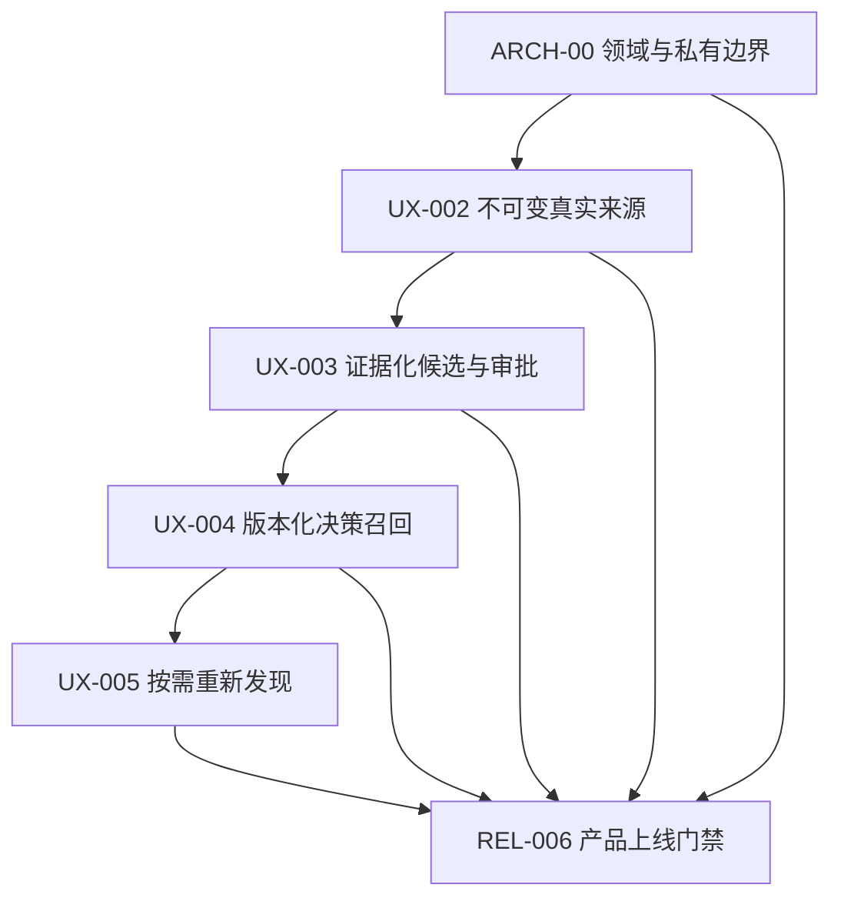

# X-Wiki｜阶段性产品与工程设计论文（实施路线）

> 版本 ROADMAP-2026-11-03；**本系列是设计/实施计划，不代表功能已经开发完成。**  
> 目标代码基线：`main@443d038`。发布后应随最新代码和产品验证结果同步更新。  
> 业务背景：[PRD v2](../PRD-v2.md) · [PH/HN 用户评论研究](../research/PH-HN-2026.md) · [产品文档中心](../README.md)

## 一、六个阶段的研究目标

| 阶段文档 | 要回答的问题 | 核心数据 / 模块 | 设计 PR 数 | 通过条件 |
|---|---|---|---:|---|
| [ARCH-00 架构与数据契约](./ARCH-00-Foundation.md) | 怎样在保留旧 Mac/Git 系统的同时建立真正的私有领域边界？ | `src/xwiki/domain`、migrations、adapters | 3 | 新模式不自动公开；旧测试不退化 |
| [UX-002 First Real Value](./UX-002-First-Real-Value.md) | 用户如何无命令行导入第一份真实数据，失败也不丢？ | SourceStore、Worker、Mac shell | 4 | 真实来源 hash 可验证、UI 状态准确 |
| [UX-003 Knowledge Review](./UX-003-Knowledge-Review.md) | 新来源怎样有证据地改变既有观点，而不是生成幻觉？ | EvidenceSpan、ChangeProposal、CAS、Review UI | 6 | 溯源、人工批准、撤销、不可意外公开 |
| [UX-004 Decision Recall](./UX-004-Decision-Recall.md) | 如何找到旧决定及其真实理由，而不是只找到关键词？ | DecisionIndex、FTS5、Claim/revision citations | 5 | 决策检索独立评测，失败能拒答 |
| [UX-005 Calm Rediscovery](./UX-005-Calm-Rediscovery.md) | 如何帮用户复用旧知识，而不制造通知噪声？ | CandidateRanker、Feedback、Opt-in | 4 | 不强制推荐、默认静默、可解释 |
| [REL-006 Product Hunt Release](./REL-006-Product-Hunt-Release.md) | 如何证明可安装、可信、可重复使用，才对外发布？ | Signed app、Privacy Gate、QA、Launch | 5 | 安全/用户/分发五层门禁全部通过 |

**合计 27 个建议 PR**，不是必须机械执行 27 次。可根据最小可合并闭环优化组合，但每个 PR 不应跨越无法回滚的数据边界。

## 二、现有代码与目标代码的映射（必须从这里开始）

| 当前真实文件 | 已具备的能力 | 迁移目标 | 风险与禁止的操作 |
|---|---|---|---|
| `scripts/import_voice_memos.py` | Apple Voice Memos 数据源发现、raw 转写 Markdown | Source adapter + immutable SourceStore | 不能修改系统 Voice Memos DB |
| `scripts/process_voice_memos.py` | SQLite 录音状态、Whisper、compile、Git publish | 旧 CLI compatibility + 新 review-first orchestrator | 默认 `git_push=True` 不可作为新私人产品默认 |
| `scripts/compile_wiki.py` | pi 暂存编译并写回 `wiki/` | Proposal-only candidate generator | 不能让 LLM 直接写批准知识 |
| `scripts/staged_workspace.py` | 工作区快照、修改路径限制 | staging helper + CAS preflight | 暂存不等于 OS 安全沙箱 |
| `scripts/compile_transaction.py` | fsync journal、冲突检测与中断恢复 | 私有 Revision writeback/outbox | 文件/SQLite 跨系统原子性仍需设计 |
| `scripts/wiki_lint.py` | public wiki lint/privacy heuristic | publication validation + semantic evidence gate（分离职责） | 启发式 scanner 不等于完整隐私审计 |
| `scripts/release_gate.py` | Git SHA/content manifest、push 确认 | 只用于经用户授权 public export | Git push 成功不等于用户私有审阅成功 |
| `scripts/verify_deployment.py` | Pages HTTP readback | 公开发布版本验证 | 不能代替逐用户授权 |
| `sites/content/demo/` | 合成的 UX-001 静态交互 | Product Hunt 预览、说明待实现的真实功能 | 不可冒充实时模型 |
| `pyproject.toml` | Ruff/Pytest 配置 | installable `src/xwiki` 项目 | CI 需同时兼容旧 `scripts/tests` |
| `wiki/` 和 `index.md` | 当前公开 Wiki | 经批准的 `public export` | 未授权私有知识不可直接写入此处 |

## 三、整体代码目标结构

```text
X-Wiki/
├── apps/
│   └── desktop-macos/                 # macOS 薄壳、权限、导入/Review/Recall UI
├── src/xwiki/
│   ├── domain/                        # 纯模型：Source, Evidence, Claim, Proposal, Revision
│   ├── application/                   # UseCases：Import, CreateProposal, Approve, Recall
│   ├── infrastructure/
│   │   ├── sqlite/                    # WAL、迁移、Repository、FTS5
│   │   ├── search/                    # 词法检索与可选语义 rerank
│   │   ├── rediscovery/               # 候选规则与通知 opt-in
│   │   └── publication/               # 私有知识转显式公开 bundle
│   └── interfaces/                    # Desktop IPC/API、CLI，无权绕过应用层
├── migrations/                        # 0001～0005；版本化，禁止破坏旧录音 DB
├── schemas/                           # 外部输入/Proposal/Span JSON Schema
├── evaluation/
│   ├── golden/                        # 已有 Wiki lint 黄金集（不得冒充证据评测）
│   ├── review/                        # Evidence grounding held-out
│   ├── recall/                        # Decision retrieval held-out
│   └── rediscovery/                   # Ranking + quiet behavior
├── tests/
│   ├── unit/                          # 纯域模型与 UseCase 单元
│   ├── integration/                   # SQLite/fsync/privacy/进程崩溃
│   ├── contract/                      # 领域和 IPC 数据契约
│   └── e2e/                           # UX-001 已有 Chromium，后续新增真实 UI E2E
├── scripts/                            # 旧 CLI 保留兼容；逐步提取 adapters
├── wiki/                               # 现有公开知识，不承载新用户私有事实源
└── docs/product/stages/               # 研究命题、设计、文件任务、验收
```

## 四、整体依赖图



重要区分：**可以在 UX-003 后先推出最小真实 Beta**，不必等待所有 P1 建成；但要符合 [REL-006](./REL-006-Product-Hunt-Release.md) 路径 B 的安全、隐私、安装和真实用户实验条件，不能把未完成 UX-004/005 宣称为产品必需能力。

## 五、严格质量准则：设计与实际交付分离

- **工程验收**：代码存在、可执行；schema/测试/真实浏览器和 macOS CI 通过；故障注入与权限负例通过。
- **产品验收**：陌生用户独立完成真实任务，耗时与理解率可测；用户能准确判断来源、AI 推断和自己批准的变更。
- **市场验证**：目标用户愿意再次用自己的资料进行知识修订；仅 Product Hunt 得票数不能替代。
- **隐私验收**：用户未明确授权时不进行模型出站请求、不发布私人信息；导出/撤销真实可执行。
- **发布声明**：所有宣传语都注明哪些是现有功能、哪些只是 UX-001 demo、哪些仍是路线图；避免“开箱即用、完全本地 AI、知识自动进化”等无据承诺。

## 六、阶段优先级与下一项具体 PR

最值得开始的是 **ARCH-00A — Domain Contracts & Packaging**，仅包含：

1. `pyproject.toml`：改为 installable src package，并保留现有 Ruff/Pytest；
2. `src/xwiki/domain/{source,evidence,knowledge,proposal,privacy,contracts,errors}.py`：纯数据契约与协议；
3. `schemas/{source,evidence,change-proposal}.schema.json`：外部 JSON 契约，含反例；
4. `tests/unit/domain/**`、`tests/contract/**`：类型/状态/偏移/JSON roundtrip；
5. 修改 `.github/workflows/quality.yml`：旧 98 Python、10 Golden、12 Chromium 及新测试共存。

**不应在 ARCH-00A 中加入云同步、自动发布或真实 UI**。它的价值是让 UX-002/003 的每一行代码都建立在明确、可测试的长期数据模型上，避免之后用数据库迁移补救前期歧义。

## 七、反馈与研究论文组织方式

本系列每份文档包含：研究命题/用户问题、现有代码依据、拟新增/修改文件、数据/接口/状态机、负例及故障注入、可衡量验收、PR 依赖关系。若后续要形成正式学术论文，仍需要独立的相关工作、实验设计、数据集授权、统计检验与复现仓库；**当前文件属于工程设计论文，而非已经完成同行评审的科研论文**。
